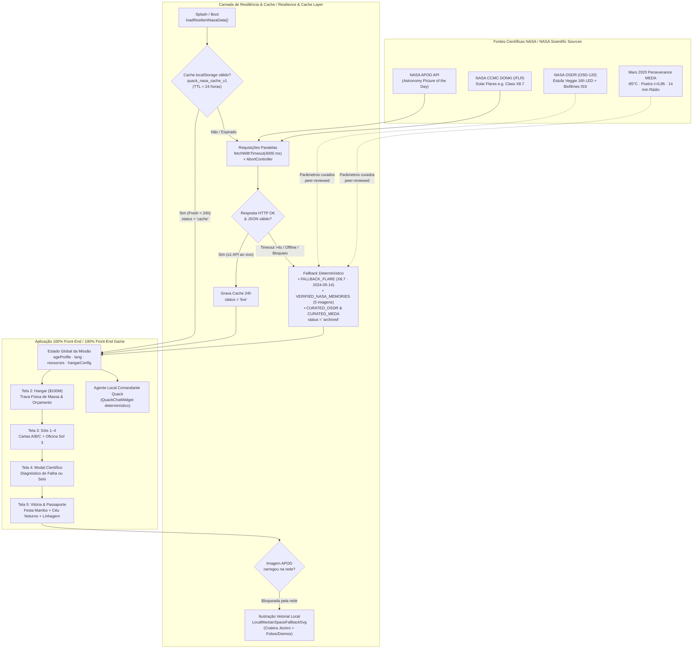

# Arquitetura Técnica / Technical Architecture

**Missão Sol-4: Guardiões da Base Ares** (*Mission Sol-4: Guardians of Ares Base*)  
**Autores / Authors:** Maryangela Costa de Souza Florentin & Luna Costa Antunes · NASA Space Apps Challenge

---

## 1. Visão Geral 100% Front-End / 100% Front-End Overview

### 🇧🇷 Português
O aplicativo foi projetado com arquitetura **100% front-end (Single Page Application em React + TypeScript + Tailwind CSS + Vite)**, sem servidor próprio, sem banco de dados externo e sem coleta de dados pessoais. Essa escolha garante:
- **Privacidade Infantil e Escolar (LGPD / COPPA by design):** nenhum dado de nome, equipe ou escolha sai do navegador do estudante.
- **Zero Custo Operacional e Alta Disponibilidade:** funciona diretamente como pacote estático em qualquer hospedagem web ou rede escolar básica.
- **Áudio Procedural sem Arquivos Pesados:** efeitos sonoros e o ritmo de Mambo cubano (*Web Audio API*) são sintetizados no navegador, sem downloads de MP3 externos.
- **Desempenho Adaptativo em Aparelhos Básicos:** camada ambiental com detecção de hardware (`hardwareConcurrency`, `deviceMemory`, `performance.memory`) e sonda de queda de FPS que alterna automaticamente de animações CSS para `requestAnimationFrame` limitado a **30 fps** com `will-change: transform`.
- **Resiliência de Interface:** `ErrorBoundary` na raiz da aplicação, timers limpos em desmontagem de componentes, fallback silencioso para área de transferência e ilustrações vetoriais locais caso redes escolares bloqueiem imagens externas.

### 🇺🇸 English
The application is architected as a **100% front-end Single Page Application (React + TypeScript + Tailwind CSS + Vite)**, with zero custom backend, zero external database, and zero personal telemetry collection. This design guarantees:
- **Child & School Privacy (COPPA / LGPD by design):** player names, team roles, and mission choices never leave the student's browser.
- **Zero Operational Overhead:** deploys as a pure static bundle capable of running reliably even on constrained school networks.
- **Procedural Audio via Web Audio API:** sound effects and the Cuban Mambo celebration groove are synthesized locally in-browser without external media downloads.
- **Adaptive Low-Spec Performance:** ambient background layers inspect hardware hints (`hardwareConcurrency`, `deviceMemory`, `performance.memory`) plus a runtime frame-drop probe, automatically switching from CSS keyframes to a **30 fps `requestAnimationFrame`** loop with `will-change: transform`.
- **UI Resilience:** root-level `ErrorBoundary`, strict cleanup of timers/intervals, clipboard fallback (`execCommand`), and silent local SVG space illustrations whenever external images are blocked.

---

## 2. Diagrama de Fluxo de Dados NASA & Resiliência / NASA Data Flow & Resilience Diagram

### Detalhamento do Fluxo / Flow Details
| Camada / Layer | Implementação / Implementation | Objetivo / Purpose |
| :--- | :--- | :--- |
| **Cache 24h** | `localStorage` (`quack_nasa_cache_v1`, `CACHE_TTL_MS = 86,400,000 ms`) | Evita excesso de chamadas em laboratórios escolares e garante abertura instantânea. |
| **Timeout Controlado** | `fetchWithTimeout` com `4.000 ms` + `AbortController` | Impede travamento da tela de abertura quando APIs externas estão lentas ou bloqueadas. |
| **Fallback Determinístico** | `FALLBACK_FLARE` (`X8.7`), `VERIFIED_NASA_MEMORIES`, `CURATED_OSDR` (`OSD-120`), `CURATED_MEDA` (`-85°C`, `τ=0.85`, `14 min`) | Garante consistência científica e jogabilidade completa mesmo offline. |
| **Fallback Visual Silencioso** | `LocalMartianSpaceFallbackSvg` + limite de retentativa por URL falhada | Evita loops de erro de imagem em firewalls escolares mantendo a estética da Cratera Jezero. |
| **Adaptação de Tom** | Catálogo central bilíngue (`Explorers`, `Strategists`, `Educators`) | Amadurece vocabulário e profundidade STEM em todas as 5 telas sem alterar regras ou layout. |

---

## 3. Guardrails do Agente Pedagógico Local (Comandante Quack) / Local Pedagogical Agent Guardrails

### 🇧🇷 Português
O chat interativo do **Comandante Quack** funciona **100% localmente e de forma determinística** (sem chamadas a LLMs externas, sem chaves de API expostas e sem risco de alucinações ou conteúdo inadequado para crianças):

1. **Zero LLM Externa & Segurança Infantil:** todas as respostas são geradas por um motor local baseado em regras semânticas, estado da missão e dados reais da NASA carregados na sessão.
2. **Guardrail Anti-Spoiler:** perguntas como *"qual carta escolher?"*, *"qual opção é a resposta?"*, *"which card?"* ou *"A, B or C?"* são interceptadas antes da resposta e redirecionadas com incentivo à autonomia científica, apontando apenas a barra mais baixa no momento e um conceito de física correspondente ao Sol atual.
3. **Adaptação Etária Rigorosa (`ageProfile`):** cada domínio de física (*gravidade*, *termodinâmica*, *velocidade da luz*, *magnetismo*, *fótons*, *momento linear*) possui redação específica para **Exploradores (7–9 anos)**, **Estrategistas (10–12 anos)** e **Pais & Professores**.
4. **Consciência Situacional em Tempo Real:** o agente lê a tela ativa, o Sol atual (`1–4`), os níveis das 4 barras (`energy`, `lifeSupport`, `shield`, `comms`), os equipamentos do Hangar, o histórico de decisões e o status dos dados NASA (`live`, `cache` ou `archived`).
5. **Segurança de Execução e Interface:** normalização de texto sem acentos para correspondência tolerante a erros de digitação, truncamento seguro do texto exibido (`slice`), limpeza obrigatória de `setTimeout` no desmonte do widget e posicionamento arrastável limitado aos limites da janela (`viewport clamping`).

### 🇺🇸 English
The interactive **Commander Quack** assistant runs **100% locally and deterministically** (no external LLM calls, no exposed API keys, and zero hallucination or child-safety risks):

1. **Zero External LLM & Child-Safe Determinism:** every reply is synthesized locally from semantic intent matching, live game telemetry, and verified NASA parameters loaded in the session.
2. **Anti-Spoiler Guardrail:** queries such as *"which card"*, *"what option"*, *"answer"*, or *"qual carta"* are intercepted and redirected without revealing Card A, B, or C—instead highlighting the lowest current gauge and a Sol-relevant physics principle.
3. **Strict Age-Profile Adaptation (`ageProfile`):** every physics domain (*gravity*, *thermodynamics*, *speed of light*, *magnetism*, *photons*, *linear momentum*) renders distinct phrasing for **Explorers (7–9)**, **Strategists (10–12)**, and **Parents & Teachers**.
4. **Live Telemetry Awareness:** the widget inspects the active screen, current Sol (`1–4`), all four resource bars, Hangar loadout, choice history, and NASA bundle status (`live`, `cache`, or `archived`).
5. **UI & Runtime Safety:** accent-insensitive text normalization, safe input slicing in echo messages, strict timer cleanup on unmount, and viewport-clamped drag positioning so the chat window never leaves accessible bounds.
