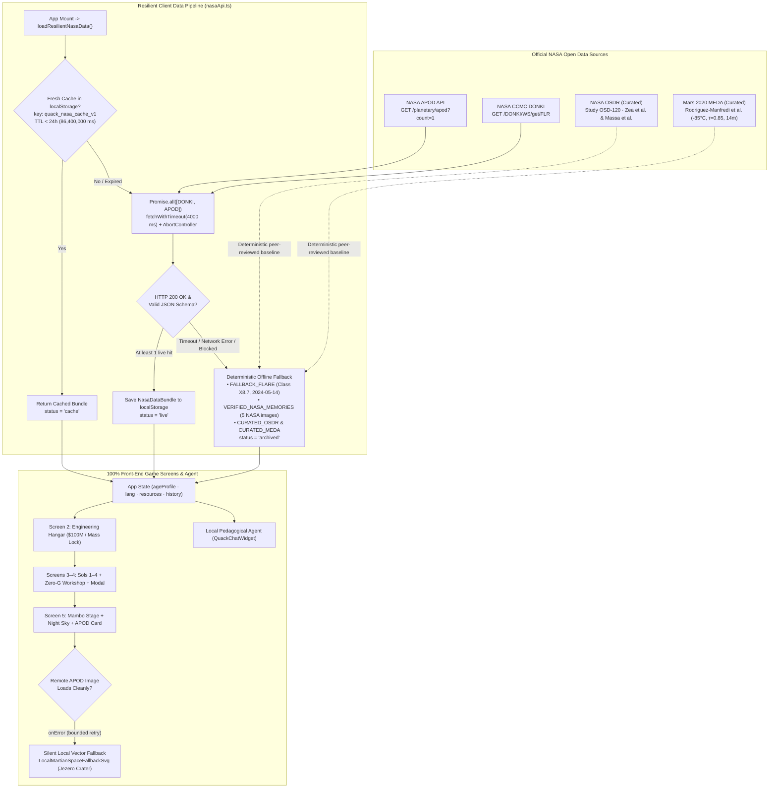

# System Architecture & Resilience Specification

**Project:** Mission Sol-4: Ares Base Guardians  
**Team:** Ares Base Guardians (*Maryangela Costa de Souza Florentin & Luna Costa Antunes*)  
**Runtime Model:** 100% Front-End Single Page Application (React · TypeScript · Tailwind CSS · Vite)

---

## 1. Architectural Principles

Mission Sol-4 is engineered to operate with **zero backend servers, zero external databases, and zero runtime LLM costs**, ensuring safe, equitable access across home devices and bandwidth-constrained public school classrooms:

1. **Privacy-by-Design (COPPA / LGPD Safe):** Player names, team rosters, and mission logs remain strictly inside client memory and local browser storage—no student data is ever transmitted to external servers.
2. **Fault-Tolerant NASA Integration:** Live API calls are non-blocking, timeout-bounded (`4,000 ms`), cached for `24 hours`, and backed by curated peer-reviewed datasets so gameplay never stalls.
3. **Procedural Web Audio Synthesis:** Sound cues and the victory Mambo groove are generated in-browser via the **Web Audio API**, eliminating external audio asset dependencies.
4. **Adaptive Low-Spec Performance:** Hardware heuristics (`navigator.hardwareConcurrency`, `navigator.deviceMemory`, Chromium `performance.memory`) and a 14-frame runtime FPS drop detector switch background animations from CSS keyframes to a single `30 fps` `requestAnimationFrame` driver with `will-change: transform`.
5. **Defensive UI & School-Firewall Resilience:** A root React `ErrorBoundary`, strict cleanup of timers/intervals, clipboard `execCommand` fallback, and a silent local Martian SVG fallback protect against restricted school networks.

---

## 2. Fault-Tolerant NASA API Pipeline



---

## 3. 24-Hour `localStorage` Caching Schema

The telemetry layer persists a single serialized `NasaDataBundle` object under the key `quack_nasa_cache_v1` with a strict `24-hour` Time-To-Live (`CACHE_TTL_MS = 24 * 60 * 60 * 1000`):

```json
{
  "status": "live | cache | archived",
  "fetchedAt": 1763218500000,
  "donkiFlare": {
    "flrID": "2024-05-14T16:46:00-FLR-001",
    "classType": "X8.7",
    "peakTime": "2024-05-14T16:51Z",
    "sourceLocation": "S18W89 (Active Region AR3664)",
    "isFallback": false
  },
  "apod": {
    "title": "Jezero Crater Delta",
    "url": "https://images-assets.nasa.gov/image/PIA24428/PIA24428~medium.jpg",
    "explanation": "...",
    "date": "2021-02-18",
    "copyright": "NASA / JPL-Caltech",
    "isFallback": false
  },
  "osdr": {
    "studyId": "OSD-120",
    "title": "Veggie Greenhouse & Microgravity Biofilm Formation",
    "ledHoursPerDay": 16,
    "crop": "Outredgeous Lettuce (Lactuca sativa)",
    "biofilmFinding": "Microorganisms form thick biofilms inside spaceflight water loops (Zea et al., ISS)"
  },
  "meda": {
    "mission": "Mars 2020 Perseverance — MEDA",
    "location": "Jezero Crater, Mars",
    "nightTempC": -85,
    "dustOpacityTau": 0.85,
    "oneWayRadioDelayMin": 14
  }
}
```

### Deterministic Fallback Rules
1. **Immediate Boot Baseline:** Before network promises resolve, state initializes synchronously with `getArchivedFallbackBundle()` so the Splash screen renders with zero loading spinners.
2. **Cache Freshness Check:** On boot, if `Date.now() - parsed.fetchedAt < CACHE_TTL_MS`, cached data is returned immediately (preventing redundant API hits across shared classroom computers).
3. **Timeout & Abort Guard:** `fetchWithTimeout` aborts stalled requests after `4,000 ms`, silently degrading to `FALLBACK_FLARE` (`Class X8.7`) and `VERIFIED_NASA_MEMORIES`.
4. **Bounded Image Re-Roll Guard:** In the Victory screen, failed remote APOD images are tracked in a `Set` (`failedUrlsRef`); after at most one verified-archive retry, the card switches silently to `LocalMartianSpaceFallbackSvg` so broken images or retry loops never occur.

---

## 4. Local Pedagogical Agent Guardrails (`QuackChatWidget`)

Commander Quack's interactive chat is implemented as a **100% local, deterministic rule-and-telemetry engine** rather than an external generative LLM:

| Guardrail | Mechanism | Educational & Safety Benefit |
| :--- | :--- | :--- |
| **Zero External LLM / Zero Hallucinations** | Deterministic semantic matcher + domain-indexed physics templates | Guarantees 100% factual NASA figures (`-85°C`, `X8.7`, `OSD-120`, `14 min`) with zero API keys or inappropriate output risk. |
| **Strict Anti-Spoiler Gate** | Regex/keyword interception for *"which card"*, *"answer"*, *"A B or C"*, *"qual carta"* | Refuses to give away Card A, B, or C; instead reports the player's lowest resource gauge and provides a physics hint for independent reasoning. |
| **Age-Profile Tone Scaffolding** | Parallel phrasing matrices per `ageProfile` (`explorers`, `strategists`, `educators`) | Adapts vocabulary across 6 physics domains (*gravity, thermo, light, magnetism, photons, momentum*) from playful analogies to formal STEM terminology. |
| **Live Telemetry & History Binding** | Reads `screen`, `currentSol`, `resources`, `hangarConfig`, `choiceHistory`, and `nasaData` | References the player's actual rocket/orbit loadout, past Sol choices, and `< 35%` danger alerts in real time. |
| **Safe UI & Lifecycle Controls** | Accent-folded input normalization, `slice(0, 36)` echo bounding, `clearTimeout` on unmount, viewport-clamped drag | Prevents XSS/overflow, memory leaks, or off-screen UI loss on small tablets and Chromebooks. |
